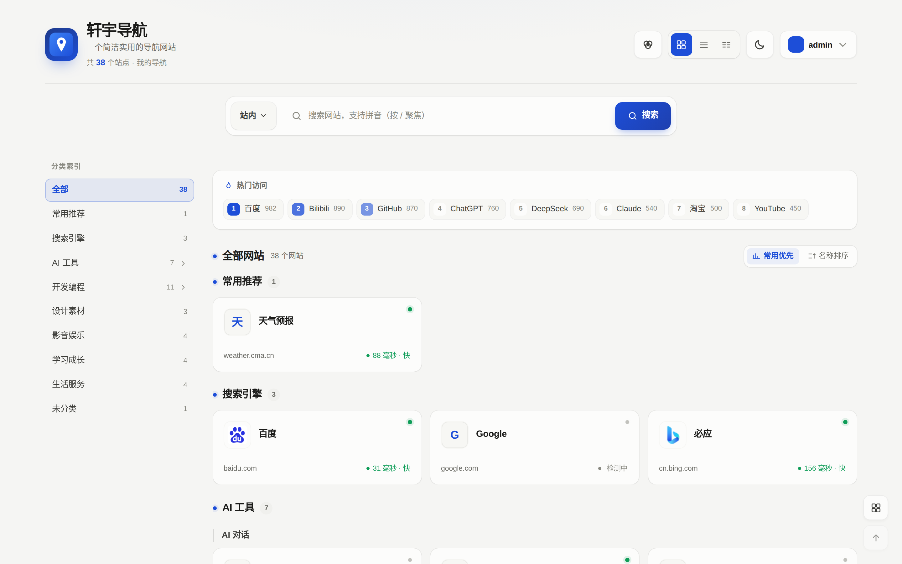
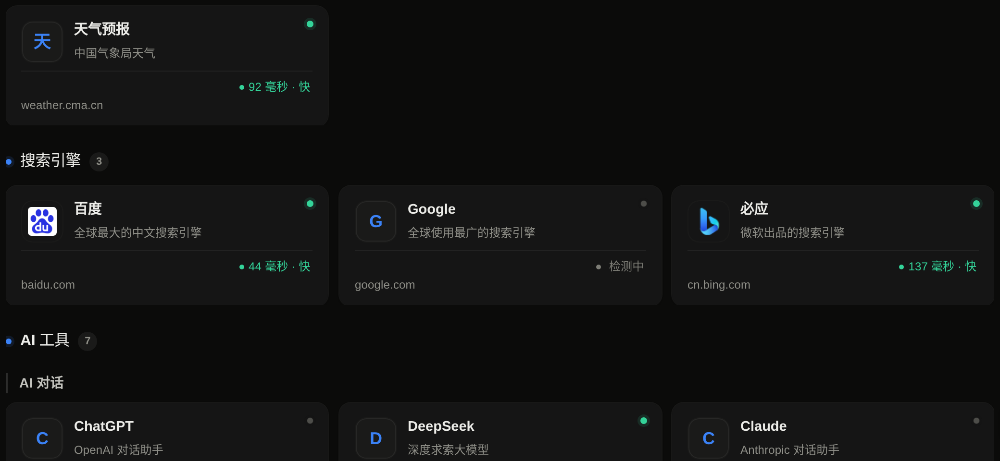
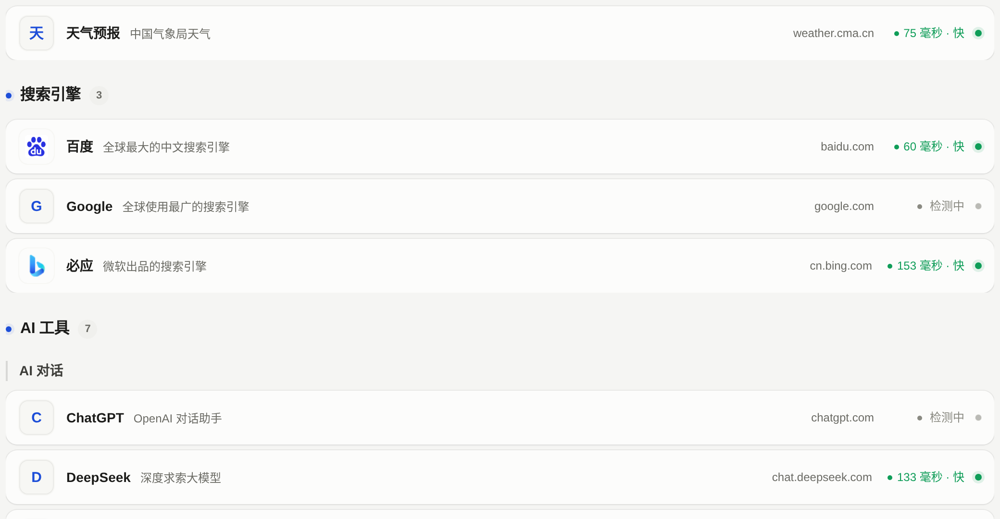

# 轩宇导航 XYdaohang

> 轻量网址导航站｜个人导航、全局语义拼音搜索、私密分组、拖拽批量管理


<p align="center">

</p>

<p align="center">
<sub>深色主题与三种卡片版式</sub><br/>


</p>

## 📌 导航

- [✨ 功能亮点](#-功能亮点)
- [⚙ 运行要求](#-运行要求)
- [📦 全新安装](#-全新安装)
- [🔄 版本升级](#-版本升级)
- [📁 目录说明](#-目录说明)
- [🔌 开放 API](#-开放-api)
- [⏰ 定时任务](#-定时任务)
- [🔒 安全说明](#-安全说明)
- [📜 更新日志](CHANGELOG.md)
- [❓ 常见问题](FAQ.md)
- [📄 许可证](#-许可证)

## ✨ 功能亮点

- **前台原生 HTML + CSS + JS，后端 PHP**：无 Node 构建链，适配虚拟主机与宝塔面板
- **全局搜索**：名称 / 别名 / 标签 / 简介 / 链接地址 / 拼音全拼与首字母联想、实时下拉候选、语义扩展（如「看视频的网站」）、最近搜索与隐私模式
- **快捷收录三步走**：搜索框粘贴网址 → 自动抓取标题、图标、描述并智能推荐分组 → 在收录工具框里校对后再落库；标题自动净化（去掉「- 某某官网」后缀）、重复收录拦截
- **三种卡片版式**：网格（浏览发现）、列表（单行四列、逐行右缘对齐）、紧凑（快速跳转，点击展开操作条）；星标收藏、悬停操作条、移动端长按菜单、右键上下文菜单、二维码分享
- **私密分组**：分组权限隔离（IDOR 防护），个人分组排序独立保存互不影响
- **整理模式**：拖拽排序、多选批量操作（移动 / 打标签 / 删除）、内联编辑、全站撤销恢复（Ctrl+Z）、批量粘贴导入
- **多用户系统**：注册登录、独立个人导航、浏览器书签导入、分享链接一键导入
- **主题与体验**：深浅色模式、多配色皮肤、3D 卡片动效、全站响应式（360px 起可用）
- **链接健康检测**：定时测速，卡片展示延迟与状态，失效自动告警邮件

## ⚙ 运行要求

- PHP 8.1（需 PDO_MySQL，建议启用 curl、mbstring、fileinfo）
- MySQL 5.7 或 8.0（utf8mb4；8.0 已实测）
- IIS 或 Apache；IIS 使用根目录 `web.config`，Apache 使用根目录 `htaccess`（部署时改名为 `.htaccess`）

> 说明：部分主机未启用 mbstring 时功能仍可运行（内部已做兜底），但中文截断只能按字节近似处理，仍建议开启。

## 📦 全新安装

1. 从 [Releases](https://github.com/xuanyu1937/XYdaohang/releases/latest) 下载最新安装包并解压到网站根目录。
2. 浏览器访问 `install.php`，在界面填写数据库、站点名称、管理员账号。
3. 安装程序自动建表（已是 v2 全量结构）、写 `config/database.local.php`、创建管理员并锁定安装。
4. 安装完成后删除 `install.php` 和 `install/` 目录。
5. 确认 `uploads/`、`cache/`、`logs/` 可写。

> 后台用到的 jQuery / Bootstrap / DataTables / Chart.js / SweetAlert2 / Font Awesome / datepicker 已随包放在 `assets/` 下，服务器无外网也能正常使用；页面里保留的 CDN 地址仅在本地文件缺失时兜底。

## 🔄 版本升级

> 所有升级操作前请**先备份数据库**（导出 SQL 或整库快照）。

### 通用规则

- 找不到对应段落时：**覆盖代码文件 → 清理 `cache/` → 强制刷新（Ctrl+F5）** 即可
- `upgrade_*.sql` 全部幂等，重复执行不报错
- v2.9.0 之后（含全部 v2.10.x）**无数据库变更**，无需执行任何 SQL

### 从 v2.13.x 及更早版本升级到 v2.15.2

覆盖代码文件，清理 `cache/`，前台强制刷新（Ctrl+F5）即可。v2.10.0 ~ v2.15.2 均无数据库结构变更，无需执行任何 SQL。

> v2.14.0 修复了「同时登录后台与前台时，前台新建分组被写成公共分类」的归属缺陷，补齐 `my.php` 5 个分组下拉与顶部分类 tab 的即时同步，并精简手机端卡片操作（常驻按钮隐藏、收藏移入长按菜单）。**此前误建为公共的分组，需在后台「分类管理 → 编辑 → 归属用户」手动改回**。v2.13.0 对 `api/` 全部端点做了真实 HTTP 审计并修复 9 个缺陷；v2.12.0 是 AI 测试连接 / 统一分类入口 / 全站快捷入口；v2.11.0 是按线上真实检测结果做的 17 项体验修复。完整清单见 [CHANGELOG.md](CHANGELOG.md) 与 [UPLOAD_LIST.md](UPLOAD_LIST.md)。

### 从 v2.8.x 升级到 v2.9.0

1. 在 phpMyAdmin 左侧先点选站点数据库，再执行 `upgrade_v2.8.1.sql`
   （脚本名带 2.8.1，实际适用 **v2.8.0 / v2.8.1 → v2.9.0**；幂等，全部为 UPDATE / INSERT...SELECT，重复执行不会产生重复数据）。
2. 上传 v2.9.0 文件覆盖旧版本。
3. 清理 `cache/` 目录，前台强制刷新（Ctrl+F5）。

> v2.8.1 之前的旧版脚本误用 `a.password_hash`（admins 表列名为 `password`），执行会报 `#1054 Unknown column`；若你手里是旧脚本请改用仓库内当前的 `upgrade_v2.8.1.sql`（已修正并加宽 password 列）。

### 从 v2.7.0 升级到 v2.8.0

1. 在 phpMyAdmin 左侧先点选站点数据库，再执行 `upgrade_v2.8.0.sql`（幂等，新建 `search_engines` 和 `user_search_engines` 两张表）。
2. 上传 v2.8.0 文件覆盖旧版本。
3. 清理 `cache/` 目录，前台强制刷新（Ctrl+F5）。

### 从 v2.6.x 升级到 v2.7.0

1. 上传 v2.7.0 文件覆盖旧版本。
2. **无需执行升级脚本**（`tags`、`alias` 字段已在 v2.5.0 存在，v2.7.0 无数据库结构变更）。
3. 清理 `cache/` 目录，前台强制刷新（Ctrl+F5）。

### 从 v2.5.x 升级到 v2.6.0

1. 在 phpMyAdmin 左侧先点选站点数据库，再执行 `upgrade_v2.6.0.sql`（幂等）。
2. 上传 v2.6.0 文件覆盖旧版本。
3. 清理 `cache/` 目录，前台强制刷新（Ctrl+F5）。

> v2.6.1、v2.6.2 无数据库结构变更，覆盖代码并清理 `cache/` 即可。

### 从 v2.4.x 升级到 v2.5.0

1. 上传 v2.5.0 文件覆盖旧版本。
2. 用 phpMyAdmin / 命令行执行 `upgrade_v2.5.0.sql`
   —— 仅新增 `nav_links.alias`（别名）、`nav_links.tags`（标签）两个可空列，不删除、不修改任何数据。
3. 清理 `cache/` 目录，前台强制刷新（Ctrl+F5）。
4. 可选：在后台「导航管理 → 编辑」为常用网址补充别名与标签，搜索联想会更精准。

### 更早版本

- **v2.2.x → v2.3.0**：执行 `upgrade_v2.3.0.sql`（新增 `users.footer_copyright` 列），覆盖代码；进入「系统设置 → 备案与版权」配置全站底部版权。
- **v2.1.x → v2.2.x**：执行 `upgrade_v2.2.0.sql`（新增 `users.reset_token_hash`、`users.reset_expires` 两列及索引）。若需「忘记密码」邮件重置，进入「系统工具 → 邮件设置与测试」填写 SMTP。
- **v2.0.x → v2.1.0**：执行 `upgrade_v2.1.0.sql`（新增 `users.avatar`、`categories.user_id`、`categories.is_private` 三列及索引）。
- **v1.1.x → v2.0.0**：覆盖代码（不要上传 `backups/`），执行 `upgrade_v2.0.0.sql`（幂等，只新增表、列、索引与设置项）；刷新后台，进入「系统设置 → 前台体验」按需开启公告、注册、联系页等。

## 📁 目录说明

- `index.php`：前台导航首页（左侧分类索引 + 分组卡片 + 热门区）
- `login.php` / `register.php` / `logout.php` / `my.php`：前台用户登录、注册、退出、个人导航管理
- `share.php`：分享链接预览页（可一键导入他人导航）
- `about.php` / `contact.php`：关于页与联系留言页
- `install.php`：全新服务器安装向导（安装后删除）
- `detail.php`：旧版详情页（保留兼容）
- `apply.php` / `apply(1).php`：收录申请入口（自动抓取已关闭）
- `admin/`：后台管理（含 `users.php` 用户管理、`stats.php` 数据统计、`tools.php` 系统工具）
- `cron/daily_check.php`：链接健康检测定时任务（按 `settings.cron_key` 鉴权）
- `api/`：
  - `site_meta.php`：前台标题异步抓取（公网地址、无跳转、超时、缓存）
  - `track_click.php`：点击量统计（v2 起同时写入 `visit_logs`）
  - `auth.php` / `user_sites.php`：前台用户认证与个人导航增删改排序（支持 `batch_move` / `batch_delete` / `batch_tag` / `batch_add` / `star` / `move` / `quick_add` / `quick_preview` 批量、快捷与收录预览操作）
  - `share.php` / `bookmark_import.php`：分享生成与导入、浏览器书签导入
  - `contact.php`：联系留言
  - `ai_suggest.php` / `health_check.php` / `stats.php`：后台抓取推荐、健康检测、统计
  - `search_index.php`：按当前视图可见性输出搜索索引 JSON（供非首页搜索面板使用）
  - `sites.php`：开放 REST API（Bearer Token 鉴权）
- `assets/`：前台主题样式与脚本；后台第三方依赖（jQuery、Bootstrap、SweetAlert2、DataTables、Chart.js、Font Awesome 等）已全部本地化，服务器无外网也能正常使用后台
- `includes/`：公共函数、配置、模板解析、服务层（`Services.php`）
- `config/`：站点、数据库、邮件、版本配置
- `template/mail/`：邮件通知模板（留言通知等）
- `docs/`：文档与 README 截图
- `backups/`：**本地源码备份，不要上传到线上**
- `install/`：安装用 SQL 与锁文件

## 🔌 开放 API

1. 后台「系统工具 → API 令牌管理」创建令牌，选择权限与过期时间（令牌明文只在创建时显示一次）。
2. 调用示例：
   ```bash
   curl -H "Authorization: Bearer <token>" "https://你的域名/api/sites.php?page=1&size=20"
   ```
3. 权限与范围：
   - `read` 只能读取，`write` 可增删改。
   - 令牌的 `user_id` 为 0 时是**管理级**：可读写公共导航与全部条目。
   - 令牌的 `user_id` 大于 0 时：只能读写该用户自己的条目。
4. 接口：`GET` 列表 / 详情（`?id=`）、`POST` 创建、`PUT` 更新、`DELETE` 删除。请求体支持 JSON 与表单编码。
5. Apache/IIS 的 `/api/sites` 短地址重写规则已写在 `htaccess` / `web.config` 中（可选，也可直接用 `/api/sites.php`）。

## ⏰ 定时任务

- 地址：`/cron/daily_check.php?key=<定时密钥>`（密钥在「系统工具 → 定时任务」生成）
- 宝塔配置：`计划任务 → 访问 URL`，建议每天 1~2 次。
- 已登录后台的管理员直接访问该地址也可执行。
- 检测结果会写入 `nav_links.check_status` / `latency_ms` / `last_checked_at`；存在失效链接且配置了 SMTP 时会发送告警邮件（可在「系统设置 → 前台体验」关闭告警）。

## 🔒 安全说明

- 远程更新、调试页已移除；后台入口仅保留登录页。
- 后台密码使用 `password_hash`；首次用旧明文密码登录会自动迁移。
- 后台登录支持双源：`admins` 表优先，其次 `users` 表中 `is_admin = 1` 的账号。
- 前台用户密码同样使用 `password_hash`，长度 8-72 位；封禁用户无法登录且会被自动登出。
- 所有写操作均有同源校验；Session 使用 HttpOnly + SameSite=Lax。
- 上传仅允许 JPG/PNG/GIF/WEBP/ICO，并校验 MIME 与图片魔数；禁止 SVG。
- 数据库口令支持 `NAV_DB_HOST`、`NAV_DB_NAME`、`NAV_DB_USER`、`NAV_DB_PASS` 环境变量覆盖。
- `config/`、`includes/`、`install/`、`backups/`、`logs/`、`cache/`、`vendor/` 已通过 IIS/Apache 规则禁止直访。
- 备份文件（`系统工具 → 数据备份` 导出的 JSON）**包含用户密码哈希与 API 令牌原文**，请当作敏感资料保管。

## 📜 更新日志

- 完整变更记录见 [CHANGELOG.md](CHANGELOG.md)
- 版本发布与安装包下载见 [Releases](https://github.com/xuanyu1937/XYdaohang/releases)

当前版本：`VERSION` / `config/version.php` = **2.15.2**（2026-11-07）

## 📄 许可证

本项目基于 [Apache License 2.0](LICENSE) 开源。
